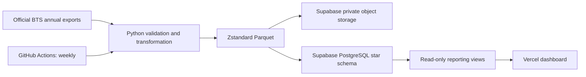

# Flightpath — US Aviation Intelligence

A real-data aviation portfolio project: **2025 full year and January–August 2026**, the latest periods verified in the downloaded BTS T-100 Domestic Segment data. Reporting coverage updates when new exports are loaded.

**[Explore the live Flightpath dashboard](https://bts-t100-market-share.vercel.app/)** · [Verified weekly refresh run](https://github.com/David2390/bts-t100-market-share/actions/runs/43356230918)

Compare passenger market share with a transparent, uncalibrated **nonstop QSI proxy**, then explore results in a Vercel dashboard. All transformations and share calculations run in Python.

## Architecture


## Data model
- `fact_market_monthly`: month × directional airport pair × reporting airline; passengers, seats, operated and scheduled departures, Python-computed shares, QSI score and load factor.
- `dim_airline`, `dim_airport`, `dim_route`, `dim_date`.
- `report_route_monthly`: Python-computed route totals used by the dashboard.
- `pipeline_status`: source provenance, quality results and refresh timestamp.

Initial load: **298,410 fact rows, 93 airlines, 704 airports, 19,252 directional routes, 20 reporting months**. These are reporting operators, not consolidated airline brands.

## Measures
- Passenger share = airline passengers / all included route-month passengers.
- Seat share and departure share use the corresponding full-market denominator.
- Load factor = passengers / seats.
- QSI proxy score = scheduled departures per day × √(average aircraft seats / 150).
- QSI proxy share = score / sum of route-month scores.
- Gap (pp) = 100 × (passenger share − QSI proxy share).

The QSI formula is an explicit portfolio assumption, **not a calibrated commercial itinerary QSI model**. Frequency enters linearly; average aircraft size enters through a square root. The 150-seat reference cancels when scores are converted to shares within a route-month. It excludes time-of-day, fares, loyalty, connections and brand preferences. T-100 measures nonstop segments, not itinerary O&D demand. Missing/zero schedule coverage can make the benchmark unavailable. Eleven airline-route-month observations report passengers above seats; they are retained and flagged rather than silently corrected. See the [full QSI methodology and worked example](docs/qsi-methodology.md).

## Multi-period and multi-route comparisons
The **Compare** section searches month names/years and route codes/cities, with multi-selection preserved while filtering. **Find more routes** queries the reporting model across the selected departure months to expand the route list. Select up to **12 departure months** and **5 directional route entries**.

- **Directional:** A → B only. **Non-directional:** A → B **plus** B → A. Opposite-direction entries are deduplicated by unordered airport pair before aggregation.
- **Selected-group passengers / seats / departures:** sums over distinct selected route × departure-month observations, including both directions only in non-directional mode. **Group load factor = total passengers ÷ total seats**.
- **Airline passenger total:** sum of that reporting airline's passengers across the exact selected route-month observations. **Airline market share of the selected group = airline group passengers ÷ total selected-group passengers**; it is not the carrier's US-wide passenger market share.
- **Route market share:** airline route passengers ÷ all carrier passengers on the same selected route(s) and months; shares are weighted by actual passenger counts, never averaged from monthly percentages.
- **Trend:** passenger totals by flight departure month, with an all-selected-routes column. A missing route-month appears as zero, not as a booking or flight estimate.
- Airline PNGs and hues follow `dashboard/brands.js` and `dashboard/assets/airlines/`. Reporting operators remain distinct. Combined QSI values are intentionally excluded because monthly normalized shares cannot simply be summed or averaged.

## Run locally
Python 3.12+:
```powershell
python -m pip install -r requirements.txt
python src/download_bts.py
python src/build_model.py
# Set DATABASE_URL securely in your environment, then:
python src/load_model.py
python -m http.server 8765 --directory dashboard
```
The downloader submits the official BTS export form; no hand-maintained temporary download link is needed. The model requires all 2025 months and contiguous published 2026 months.

## Storage
Untouched downloads stay outside Git. Raw and modeled data are stored as Zstandard-compressed Parquet in the private `aviation-parquet` Supabase Storage bucket. PostgreSQL holds queryable relational tables; PostgreSQL does not store those tables internally as Parquet.

The initial raw CSV content totals approximately 212 MB; the corresponding bronze Parquet files total approximately 23.5 MB (about 89% less). All eight Parquet files, including modeled reporting data, total approximately 43.1 MB. See [quality/provenance report](reports/data-quality.json).

## Deployment and refresh
- Vercel account/team: `davidemendez14-3404`.
- The [static Vercel dashboard](https://bts-t100-market-share.vercel.app/) reads public, SELECT-only Supabase reporting views with a publishable client key. The initial deployment used a `dashboard/` folder upload. The project is now connected to this GitHub repository for automatic deployments from `main`, with Vercel Root Directory set to `dashboard`.
- GitHub Actions runs Mondays at 10:17 UTC / 06:17 Bolivia time, plus manual dispatch. `REFRESH_ENABLED=true` activates the job.
- `DATABASE_URL` belongs in GitHub Actions Secrets, never source code. The dedicated `aviation_loader` login has access only to this project's reporting schema.
- The entire database load is transactional. Failed loads preserve the previously published data. Refreshes do not require redeploying the dashboard.
- GitHub Actions also retains compressed Parquet artifacts for 30 days. The workflow uploads a versioned private Supabase Storage snapshot before updating the report, retaining the current and previous snapshots. Storage credentials are held in the SUPABASE_S3_ACCESS_KEY_ID and SUPABASE_S3_SECRET_ACCESS_KEY Actions secrets.

See [architecture and operations](docs/architecture.md), the [data source](docs/data-source.md), and the [dashboard visual system and airline mark provenance](docs/design-and-marks.md).
